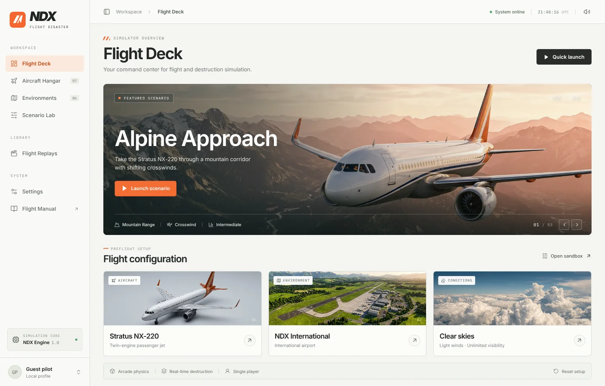

# NDX Flight Disaster

A standalone, **playable single-player 3D flight and destruction sandbox**. The Flight Deck is the launcher, not the simulation: launching a flight loads a real Three.js world, original Blender airframes, and a fixed-step Rapier/WASM physics simulation. No video or prerecorded crash animation is used.



## Publish the game website

This repository supports two deployments of the same game:

| Edition | Host | Saves |
|---|---|---|
| **Public play site** | GitHub Pages or any static web host | Device-local flight setup, scenarios, flight log and replays; no sign-in |
| **Full-stack site** | The included Node.js server with a persistent volume | All local features plus accounts, cloud profile sync and owner administration |

For this repository, the intended Pages address is **https://robloxgamee1231-ctrl.github.io/Plane/**. An administrator must select **Settings → Pages → Build and deployment → Source: GitHub Actions**. Merge the website PR into `main`; the **Website** workflow builds, browser-tests and publishes the site. If Pages is enabled after merging, run **Actions → Website → Run workflow** on `main`. PR checks do not publish unreviewed code.

To build the same portable static site yourself, run `npm ci && npm run build:site`. Upload **the contents of `out/site/`**, not the source repository. All artwork, fonts, 3D models and lazy-loaded modules resolve relative to the site, so it also works under a subdirectory. See [deployment instructions](docs/DEPLOYMENT.md).

## Run it

Requires **Node.js 22.13+** (tested on 22.22.3), npm, and a browser with WebGL 2 enabled.

```sh
npm ci
npm run dev
```

Open **http://localhost:5173**. The same origin serves the frontend, local models, textures, fonts, and account API. There are no runtime CDNs, external API keys, model downloads, or mandatory sign-ins. The development server also accepts Arena's proxied preview host.

### First flight

1. Click **Quick launch** to enter the airport at cruise speed, or **Launch scenario** for the featured alpine flight.
2. Use **W/S** to pitch, **A/D** to bank, and **Q/E** for yaw. **Shift** increases throttle; **Ctrl** or **−** reduces it. **G** toggles gear and **Space** brakes.
3. Press **C** to switch cameras; drag the scene to orbit. **T** toggles quarter speed. **P** or **Esc** pauses/resumes.
4. In **Events**, choose **Structure stress test**. The observer view moves to a fictional test structure as its unsupported panels and slabs separate and fall. Try **District stress test** for a staggered, larger collapse. Switch back to **Chase** to resume flying.
5. Use **Save replay**, or **End flight → Finish session** with the replay option checked. Open **Flight Replays** to scrub time, adjust speed, and switch views.

## Included

- **Seven original aircraft:** Stratus NX-220, Meridian H-90, Atlas C-40, Vela J-8, Kestrel X-1, Solace P-6, and Aether V-12. Different dimensions, masses, inertial response, cruising speeds, and structural strengths. Orbit the real model in the hangar.
- **Six seeded, fictional regions:** NDX International, NDX Metropolis, Coastline, Desert Valley, Mountain Range, and Future City. Each has a 9 × 9 km terrain mesh, a bounded flight sector, and modular buildings. Scenery includes terminals, a control tower, settlements, industrial blocks, bridges, water, forests, and illuminated high rises.
- **Flight dynamics:** lift, drag, wind-relative velocity, thrust, gravity, control authority, angular motion, arcade stability assistance, landing friction, braking, and simplified water interaction.
- **Hybrid destruction:** individual aircraft components, visible deformation, contact-driven failure, supported building modules, physical wall panels and slabs, pooled dust/smoke/sparks, and cheaper distant debris. See [physics architecture](docs/ARCHITECTURE.md).
- **Flight modes:** Free flight, Sandbox, Random disaster, Aircraft damage lab, City destruction lab, and a nine-gate checkpoint challenge, plus a separate cinematic replay theater.
- **Scenario editor:** airframe, map, mode, weather, lighting, altitude, turbulence, physics mode, and world seed. Save up to 32 named presets per profile.
- **Six camera positions:** chase, cockpit, external orbit, ground observer, free camera, and cabin. Live and replay speed controls are independent of camera mode.
- **Replay recorder:** up to 90 seconds / 720 samples of actual aircraft/debris transforms, separation times, and structure state. Playback interpolates poses and reconstructs the same seeded world. The most recent eight recordings per pilot are stored on this device in IndexedDB.
- **Original synthesized audio:** engine tones, air noise, impacts, panel sounds, alerts, and menu feedback. Camera-relative stereo positioning and distance attenuation. Sound is user-activated and can be muted.
- **Accounts and saves:** guest local storage, password-based pilot registration/login, HttpOnly sessions, SQLite-backed configuration/preset/statistics synchronization, and the owner-only administration console. Recent statistics cover the latest 64 logged flights. Raw replays intentionally remain device-local.
- **Performance settings:** Low/Medium/High/Ultra, adaptive pixel density, instanced scenery, distant aircraft LODs, sleeping rigid bodies, and bounded debris budgets.

## Owner account

The reserved account is **NDX**. There is **no shared or hardcoded password**. A first development boot generates a random bootstrap credential in `.data/owner-bootstrap.txt` with owner-only file permissions. Read it privately on the server, sign in using **Guest pilot → Sign in**, and store it in a password manager. Do not commit or share it. The data directory is ignored by Git and denied by the development file server.

The owner console lists profiles and can revoke a non-owner pilot's sessions after confirmation. Authorization is enforced by the API, not by UI visibility. The owner cannot be claimed through registration. Production bootstrap requires an externally supplied secret; see [deployment](docs/DEPLOYMENT.md).

## Project layout

| Path | Contents |
|---|---|
| `src/ui`, `src/App.tsx` | Responsive Flight Deck, hangar, editor, profiles, replay library, HUD |
| `src/game/engine.ts` | Fixed-step flight, collision handling, modular damage, cameras, recorder |
| `src/game/world.ts` | Seeded environments, terrain, modular buildings, colliders, instanced props |
| `src/game/recording.ts` | Compact transform format and IndexedDB library |
| `src/game/audio.ts` | Original Web Audio synthesis and spatial mixing |
| `assets/blender/` | Editable Blender sources for seven aircraft and environmental props |
| `public/models/` | Seven modular GLBs with control-surface animation, seven LOD GLBs, and prop library |
| `public/textures/`, `public/art/` | Original generated surface textures, scenario artwork, Blender fleet renders |
| `scripts/` | Repeatable Blender modeling, LOD/export, thumbnail, and texture pipelines |
| `server/` | Native Node API, SQLite schema/bootstrap, sessions, production web server |
| `tests/`, `docs/` | Executable checks, QA report, architecture, deployment, development checklist |

## Build and verify

```sh
npm run build             # strict TypeScript check and production bundle
npm test                  # isolated database/API and asset integrity tests
npm run test:browser       # real website/flight/replay/account flows; dev server running
npm run test:worlds        # all seven aircraft, six regions, modes, landing and water tests
npm run test:production    # isolated production server + real browser smoke test
npm run build:site         # portable public play site, no server required
npm run test:site          # real browser check on a static /Plane/ subpath
```

The default browser runner uses packaged Linux x64 Chromium/SwiftShader. Set `CHROME_PATH` to an installed Chromium-family executable on another supported platform. Browser tests write screenshots and machine-readable reports to ignored `test-results/`. `NDX_TEST_URL` changes the development test origin.

- [Testing report and verified scope](docs/TESTING.md)
- [Development checklist](docs/CHECKLIST.md)
- [Asset pipeline](docs/ASSETS.md)
- [Production deployment](docs/DEPLOYMENT.md)

**Scope:** this release prioritizes a complete local single-player simulation. Network multiplayer is not implemented. The abstract airframes, stability assists, support columns, and fracture pieces are game mechanics, not engineering models or real aviation training. Photorealistic launcher art is illustrative; the interactive world uses original real-time 3D assets.
