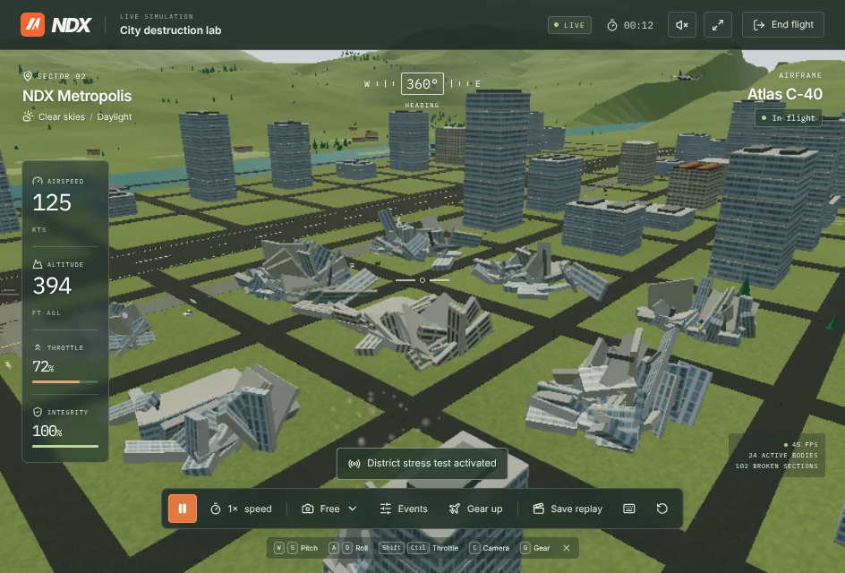
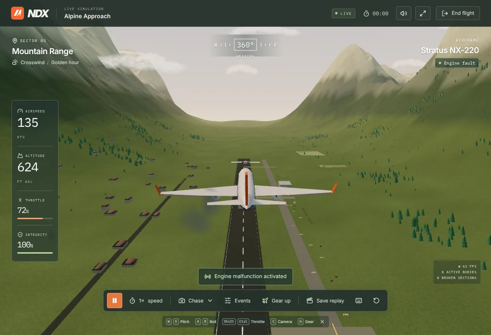

# Testing report — 2026-11-18

## Result

**The actual website, 3D game, accounts, and production build were launched and exercised in a browser.** The verified scope is the single-player game, not an unimplemented multiplayer service. The screenshots below are browser captures of the running software.

- Node 22.22.3, strict TypeScript build, Vite production bundle: **passed**.
- `npm test`: **15/15 passed** — seven backend/persistence/authorization checks and eight binary asset-library checks.
- `npm run test:browser`: **19 passed checks**, including real UI interactions and solver contact assertions. No uncaught application or WebGL shader errors in the exercised flows.
- `npm run test:worlds`: **seven successful aircraft sessions covering every map**, both flight physics settings, all six flight modes, and additional landing, water, camera, restart, fault, and district-collapse checks.
- Fresh production process and genuine browser smoke flow: **passed on Chromium 140.0.7339.0 and 131.0.6778.0**. The shipped bundle does not expose the development inspection handle.

[Browser results](qa/browser-report.json) · [World results](qa/world-report.json) · [Chromium 140](qa/production-140.json) · [Chromium 131](qa/production-131.json)

## Public website distribution

`npm run build:site && npm run test:site` passed in Chromium 140.0.7339.0 against static files at `/Plane/`, with no Node account service. Verified decoded dashboard images and fonts, the local profile, model/texture loading, flight pause/resume, structural stress, saving a replay, and playback after a reload. There were no failed asset requests, requests outside the mount, account API calls, or uncaught page errors. This is a validation of the publishable artifact, not a claim that a public Pages deployment has already completed.

## Destruction results

In a repeatable aircraft–structure contact fixture, Rapier contacts — not the stress-test command — released two additional structural modules. Aircraft integrity dropped from 97.6% to approximately 68.5%, and five aircraft components were detached in the session. Independent debris positions changed over subsequent solver steps. The intact building was not simply hidden without replacement.

In the **Metropolis district stress test**, the test district contained **927 static structural modules**. A staggered support test and its resulting collapses released **102 modules**, produced **306 visible debris pieces**, and observed a **peak of 24 active debris bodies**, exactly the Low preset limit. The rest used cheaper settling/ballistic updates. The aircraft and scenery remained present and the session could be ended normally. These are measured counts from this seed and run, not universal performance guarantees.

## Requested test matrix

| # | System | Verification |
|---:|---|---|
| 1 | Website loading | Real landing page, backend health, local fonts/artwork, desktop screenshot, responsive 390px screenshot, no horizontal overflow. |
| 2 | Game launch | Dashboard Quick launch, featured launch and editor launch all entered a WebGL2 scene with a Rapier world. |
| 3 | Aircraft selection | Selected Vela in the live 3D hangar, confirmed dashboard selection, and loaded all seven original models in actual flights. GLB sections, UVs, animation clips, smaller LOD and Blender source were checked. |
| 4 | Movement | World position advanced more than 20 game meters over the flight sample. Keyboard roll changed the body quaternion; throttle input changed the live engine setting. |
| 5 | Flight physics | Stable airborne motion, both assist settings, induced wind/fault scenarios, gear extension, gentle landing and brake slowdown. Ground fixture settled at about 2.85 m body-center height, with full integrity and near-zero speed. Water entry applied drag/buoyancy and impact damage. |
| 6 | Collisions | A deterministic fixture initialized an aircraft next to an intact fictional module; actual solver contacts produced damage and releases. Ground contact stopped the aircraft above the terrain. |
| 7 | Aircraft damage | Door release, component collider removal, changed handling/engine power, contact damage, separated original model pieces, and integrity reporting. |
| 8 | Building destruction | Both natural collision-triggered damage and deliberate test loads. Localized and district-scale failures, dependent section release, and remaining intact neighbors. |
| 9 | Debris | Moving/rotating fragments, capped rigid-body count, far/sleeping fallback, persistent aftermath. The 306-piece stress case stayed within its 24-body limit. |
| 10 | Cameras | All six camera transforms finite; cockpit and orbit selected by keyboard, observer view on structural test, interactive orbit preview. Fullscreen entered and exited. The cockpit instrument texture uses live aircraft state. |
| 11 | Time controls | Quarter-speed toggle checked; paused clock stayed unchanged during a real wait; resume returned to stepping. |
| 12 | Replay | Saved a real flight, rebuilt the seed on a different graphics preset, scrubbed from zero to eight broken modules, restarted playback at the end, and exited the theater. |
| 13 | Scenario editor | Changed mode, aircraft, altitude, map, weather, light and physics controls; saved and reloaded a named preset. |
| 14 | Map loading | All six scenes contained real mesh geometry, static colliders, original aircraft, valid motion and structural components. See session table. |
| 15 | Sound | Actual AudioContext running, nonzero master gain, changing engine oscillator frequency, camera-relative mixer and triggered collision/fault effects. Automated signal/state verification, not a subjective listening evaluation. |
| 16 | Graphics settings | Low preset persisted after reload, Medium rebuilt an identical replay layout, default High launched in the production smoke test. Quality-tier budgets are explicit; no unsupported hardware FPS claim. |
| 17 | Registration | Browser registration created the pilot, protected duplicate names, and created an HttpOnly authenticated session. |
| 18 | Login and permissions | Logout invalidated the session; login restored the profile. Invalid credentials and non-owner administration rejected. Reserved owner bootstrap, owner-only list and session revocation verified against isolated SQLite. |
| 19 | Save systems | Local settings survived reload; presets and logs synchronized to SQLite and survived sign-out/sign-in. Replay persisted independently in IndexedDB. |
| 20 | Browser compatibility | Actual Linux Chromium 140 and 131 production launches, desktop sizes, and 390 × 844 mobile viewport. Human testing on physical Safari/Firefox/mobile GPUs is not claimed. |

## All-aircraft / all-map runs

| Airframe | Region | Mode | Structural modules in tested seed |
|---|---|---|---:|
| Stratus NX-220 | NDX International | Free flight | 148 |
| Vela J-8 | Coastline | Checkpoint challenge | 88 |
| Meridian H-90 | Mountain Range | Random disaster | 88 |
| Atlas C-40 | NDX Metropolis | City destruction lab | 927 |
| Solace P-6 | Desert Valley | Aircraft damage lab | 64 |
| Aether V-12 | Future City | Sandbox | 1,018 |
| Kestrel X-1 | NDX International | Sandbox and restart | 148 |

The challenge fixture passed the first gate through flight; the random-fault scheduler fired and scheduled its next event; the damage lab reduced engine power after its configured delay. Electrical, navigation and hydraulic faults plus system restoration were exercised in Future City. A scene restart rebuilt the airframe and reset its clock.

## Issues found and corrected

- Reused the WebGL context and switched the hangar to on-demand rendering instead of redrawing an idle model or recompiling the renderer for every selection.
- Corrected form label associations so segmented control buttons retain their own accessible names.
- Tuned contact energy thresholds so a significant contact can separate the struck hull section, not merely change a global health number.
- Fixed replay-at-end playback when range-input precision rounded the timestamp slightly below the last sample.
- Isolated terrain-detail randomness from structural layout generation so changing graphics quality cannot move buildings in a replay.
- Inspected the cockpit in the browser, replaced opaque inward-facing glazing with clear frames, and added live airspeed, altitude, attitude and system instruments.
- Confirmed unmount/restart releases physics resources, audio graphs, listeners, renderer resources and WebGL contexts.

## Reproduce

Use the commands in the root README. `test:browser` and `test:worlds` use the running development site. In CI, use a separate `NDX_DATA_DIR` and `NDX_TEST_URL` for browser-created test accounts. `test:production` starts and cleans up its own isolated production server/database. Set `CHROME_PATH` to repeat against another installed Chromium-family binary.

The browser tests use ordinary UI and keyboard/pointer actions. For repeatable collision/landing fixtures, a development-only handle advances the **same** game physics step rather than waiting for software rendering. Physics is not mocked. The production smoke exercises the public UI only. SwiftShader screenshots and instantaneous HUD FPS are not consumer-GPU benchmarks.

**Not verified or shipped:** public multiplayer, an external permanent deployment, physical mobile thermal behavior, Safari/Firefox compatibility, a security audit, or engineering-grade aerodynamic/structural accuracy.
